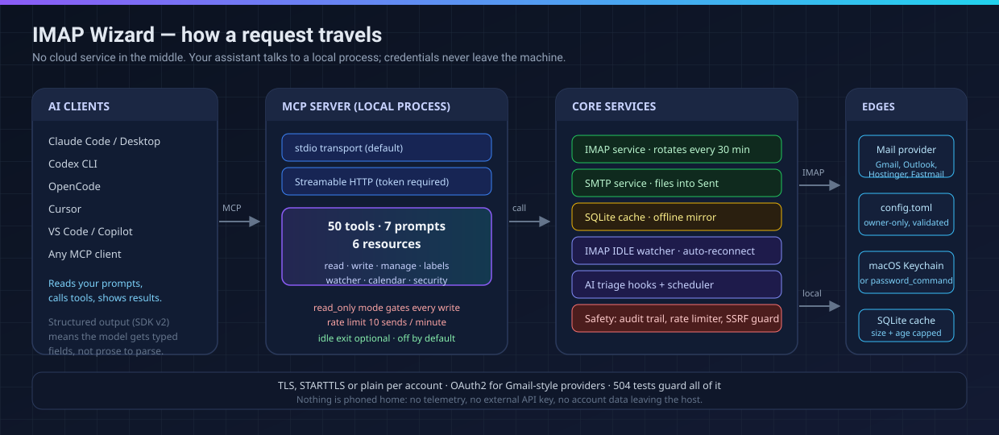

<div align="center">

# IMAP Wizard


**Let your AI assistant read, search, send and sort your email over plain IMAP and SMTP.**

[](https://github.com/Fe2-O3/imap-wizard/releases)
[](https://www.npmjs.com/package/imap-wizard)
[](LICENSE)
[](#development)
[](https://nodejs.org)

<a href="#quick-start">Quick start</a> ·
<a href="#what-you-can-ask-for">Examples</a> ·
<a href="#safety-and-privacy">Safety</a> ·
<a href="#tools">Tools</a> ·
<a href="#configuration">Config</a> ·
<a href="#other-clients">Clients</a> ·
<a href="#troubleshooting">Troubleshooting</a>

</div>

- **Local and private.** It runs on your machine and talks straight to your
  mail server. No cloud service in the middle, no telemetry, no account to make.
- **Safe by default.** Reading never marks mail as read. A read-only mode hides
  every write tool. Retried sends are caught, and email text is marked as
  untrusted so a message cannot pose as instructions.
- **Fixes real bugs.** It is a fork of
  [codefuturist/email-mcp](https://github.com/codefuturist/email-mcp) that fixes
  bugs upstream still has. [See the list](#relationship-to-upstream).

Works with Claude Code, Claude Desktop, Cursor, VS Code, Windsurf, Codex,
OpenCode and any other [MCP](https://modelcontextprotocol.io) client. Supports
several accounts at once.

---

## Quick start

You need **Node.js 22.13 or newer** (24 recommended).

**1. Add your account.** A wizard asks for your address and password. It fills
in the server settings for common providers.

```bash
npx -y imap-wizard account add
```

**2. Check it works.** This logs in to IMAP and SMTP for every account.

```bash
npx -y imap-wizard test
```

**3. Connect your AI client.**

Claude Code:

```bash
claude mcp add email -- npx -y imap-wizard stdio
```

Claude Desktop, Cursor or Windsurf: run the installer. It finds those apps,
asks which ones to set up and how to launch the server (pick `npx`), then
writes the config. Restart the app after.

```bash
npx -y imap-wizard install
```

Any other client takes this JSON (more formats under
[Other clients](#other-clients)):

```json
{
  "mcpServers": {
    "email": {
      "command": "npx",
      "args": ["-y", "imap-wizard", "stdio"]
    }
  }
}
```

Now ask your assistant: *"What's unread in my inbox?"*

<details>
<summary><strong>Other ways to install</strong></summary>

<br>

- **Global command:** `npm i -g imap-wizard`, then use `imap-wizard` in place of
  `npx -y imap-wizard` (for example `imap-wizard account add`).
- **Docker:** `ghcr.io/fe2-o3/imap-wizard` (tags `v0.3.3` and `latest`). See
  [Docker](#docker).
- **MCP Registry:** listed as `io.github.Fe2-O3/imap-wizard`.
- **From source:**

  ```bash
  git clone https://github.com/Fe2-O3/imap-wizard.git
  cd imap-wizard
  pnpm install && pnpm build
  node dist/main.js account add
  ```

  Then point your client at `node /absolute/path/to/imap-wizard/dist/main.js stdio`.

</details>

> [!NOTE]
> Config is stored in `~/.config/email-mcp/`. The folder name is kept from
> upstream, so an existing email-mcp setup keeps working unchanged.

---

## What you can ask for

| Say this | What runs |
|---|---|
| "What's unread and older than a week?" | `list_emails`, sorted by date |
| "Find the Acme invoice from this month and save the PDF to my Downloads folder" | `search_emails`, `get_email`, `download_attachment` with `savePath` |
| "Reply to that thread: Thursday works, cc billing" | `reply_email` (uses Reply-To, files the reply in Sent) |
| "Is this sender legit?" | `get_email_security` (DMARC, SPF and DKIM results from the headers) |
| "Save that message as a file" | `export_email` (writes a `.eml` file) |
| "Triage my inbox and skip the newsletters" | `triage_inbox` prompt |
| "Move last month's receipts into Receipts" | `search_emails`, then `bulk_action` |

---

## Why this one

- **Bugs fixed that upstream still has.** As of upstream v0.6.0: duplicate
  sends on retry, `read_only` not stopping background work, stdio processes
  that never exit, "Re: RE:" subjects stacking, and Sent copies rejected by
  strict servers. [Full list with upstream status](#relationship-to-upstream).
- **Reading never changes your mailbox.** `get_email` and `export_email` fetch
  with IMAP `BODY.PEEK`. Mail stays unread unless you ask (`markRead: true`).
- **A real read-only mode.** With `read_only = true`, write tools are not
  registered at all, so the assistant cannot even see them.
- **Handles big mailboxes.** Message fetches go out in chunks, so a mailbox with
  tens of thousands of messages does not overflow the server's command limit.
- **Does not hang.** Waiting for a mailbox lock stops after 60 seconds. A stuck
  connection is closed and opened again.
- **No plaintext passwords needed.** Use the macOS Keychain, Linux
  `secret-tool`, a password command (1Password, Bitwarden, `pass`), or OAuth2.
- **Fewer tools when you want them.** A `core` or `minimal` toolset sends the
  model a shorter list. Handy for local models.

---

## Safety and privacy

| Control | Default | What it does |
|---|---|---|
| Non-destructive reads | always | Reads use `BODY.PEEK`. Marking read takes an explicit `markRead: true` |
| `read_only` | off | Hides every write tool and stops background services. `markRead` is refused |
| Send rate limit | 10 per minute per account | Set with `settings.rate_limit` |
| Duplicate-send guard | on | A retried send is spotted and refused unless you pass `allow_duplicate` |
| Audit log | on | Writes are logged, with sensitive fields hidden, to `~/.local/share/email-mcp/audit.log` |
| Untrusted-content markers | always | Email text in tool output is wrapped in `<<<UNTRUSTED_EXTERNAL_CONTENT>>>` markers that tell the model it is data, not instructions |
| Safe file saving | always | `download_attachment` and `export_email` save only to absolute paths, never overwrite a file, and refuse system folders, hidden folders, the home folder itself and this app's own folders |
| Protected mailboxes | always | `delete_mailbox` and `rename_mailbox` refuse INBOX, Sent, Drafts, Trash, Junk and Archive |
| Encrypted logins | enforced | A config with `tls = false` and `starttls = false` to a non-local host is refused when it loads |
| Credential redaction | always | Passwords and tokens in error text become `[redacted]`. The server's own reason for a failed login is kept |
| Mailbox-lock timeout | 60 s | A stuck connection is recycled instead of freezing later calls |
| HTTP transport token | required | `http` mode makes a bearer token, even on localhost |
| Verification-code tool | off | `get_verification_code` exists only when you turn it on. It never reads your clipboard |
| Body cache (`read_through`) | **off** | Message bodies are saved to disk only if you turn it on. [Details](#local-body-cache-opt-in) |

**What is on disk by default:** your `config.toml` (readable only by you), the
audit log, and a local SQLite copy of message **headers and flags** for INBOX
over the last 90 days. Turn that copy off with `settings.cache.enabled = false`.
Message bodies are not stored unless you turn on `read_through`.

To report a security problem, follow [SECURITY.md](SECURITY.md). Please do not
post exploits in public.

---

## Tools

**51 tools** (26 read, 25 write), plus **1 opt-in tool**, **7 prompts** and
**6 resources**. In read-only mode only the 26 read tools are registered.

| Group | Tools |
|---|---|
| **Read mail** | `list_accounts` `list_mailboxes` `list_emails` `search_emails` `get_email` `get_emails` `get_email_status` `get_thread` `download_attachment` `export_email` `find_email_folder` `extract_contacts` `get_email_stats` `get_email_security` `check_health` `list_templates` |
| **Calendar (read)** | `extract_calendar` `analyze_email_for_scheduling` `list_calendars` `list_events` `list_reminders` `check_calendar_permissions` |
| **Watcher (read)** | `get_watcher_status` `list_presets` `get_hooks_config` `check_notification_setup` |
| **Send** *(write)* | `send_email` `reply_email` `forward_email` `save_draft` `send_draft` `apply_template` |
| **Schedule** *(write)* | `schedule_email` `list_scheduled` `cancel_scheduled` |
| **Organize** *(write)* | `move_email` `delete_email` `mark_email` `bulk_action` `create_mailbox` `rename_mailbox` `delete_mailbox` |
| **Labels** *(write)* | `list_labels` `add_label` `remove_label` `create_label` `delete_label` |
| **Calendar and alerts** *(write)* | `add_to_calendar` `create_reminder` `configure_alerts` `test_notification` |
| **Opt-in** | `get_verification_code` (needs `settings.verification.enabled = true`) |

**Prompts:** `triage_inbox` `summarize_thread` `compose_reply`
`draft_from_context` `extract_action_items` `summarize_meetings` `cleanup_inbox`

**Resources:** `email://accounts` `email://{account}/mailboxes`
`email://{account}/unread` `email://{account}/stats` `email://templates/{name}`
`email://scheduled`

### Toolsets

If your client or model struggles with a long tool list, send fewer tools with
`settings.toolset` (env var `MCP_EMAIL_TOOLSET`):

| `toolset` | Tools (normal / read-only) | What's in it |
|---|---|---|
| `"full"` (default) | 51 / 26 | Everything above |
| `"core"` | 21 / 9 | Minimal, plus `get_emails`, mark, move, delete, labels, drafts, `forward_email`, `download_attachment`, `export_email` |
| `"minimal"` | 8 / 6 | `list_accounts` `list_mailboxes` `list_emails` `search_emails` `get_email` `get_thread` `send_email` `reply_email` |

Prompts and resources stay in every toolset.

Also included: Streamable HTTP transport, an IMAP IDLE watcher with optional AI
triage (off by default), provider auto-detection for Gmail, Outlook, Yahoo,
iCloud, Fastmail, Proton Mail Bridge, Zoho and GMX, and a terminal CLI
(`list`, `read`, `search`, `send` and more).

<p align="center">
  
</p>

---

## Configuration

Config lives at `~/.config/email-mcp/config.toml`. `imap-wizard config path`
prints it. The `account add` wizard writes it for you. A typical file:

```toml
[settings]
read_only = false   # true hides every write tool
toolset = "full"    # "core" or "minimal" for a shorter tool list
rate_limit = 10     # max sends per minute per account

[[accounts]]
name = "personal"
email = "you@example.com"
full_name = "Your Name"
password = "use_keychain:personal"   # stored in the OS keychain

[accounts.imap]
host = "imap.example.com"
port = 993
tls = true

[accounts.smtp]
host = "smtp.example.com"
port = 465
tls = true
```

Check any edit with `imap-wizard config validate`. It names the bad line,
suggests fixes for misspelled keys, and exits `1` on errors, so it also works
in CI.

<details>
<summary><strong>Password options</strong></summary>

<br>

- **OS keychain:** `password = "use_keychain:<name>"`. macOS uses Keychain,
  Linux uses `secret-tool` (libsecret). `imap-wizard keychain migrate` moves
  existing plaintext passwords over.
- **Password command:** `password_command = "op read 'op://Private/mail/password'"`
  (or `bw get password ...`, `pass show ...`). It runs once at startup, must
  print the password, and is stopped after 10 seconds. It wins over `password`
  if both are set.
- **OAuth2:** an `[accounts.oauth2]` block instead of a password.
- **Plaintext:** allowed. The file is readable only by you, and `config show`
  hides the password.

</details>

<details>
<summary><strong>Other settings worth knowing</strong></summary>

<br>

| Setting | Default | Meaning |
|---|---|---|
| `settings.idle_exit` | `0` (off) | Seconds without a request before the stdio server exits. A backstop for clients that never close the pipe |
| `settings.send.max_attachment_mb` | `25` | Cap on attachments per message. Known providers may lower it. An account-level `max_attachment_mb` overrides it |
| `settings.cache.enabled` | `true` | Local header-and-flags copy (`mailboxes = ["INBOX"]`, `window_days = 90`, `max_size_mb = 500`) |
| `settings.watcher.enabled` | `false` | IMAP IDLE watcher for new mail, with optional hooks and alerts |
| `settings.verification.enabled` | `false` | Registers `get_verification_code` |

</details>

### Environment variables (one account, no config file)

Set these in your client's MCP config instead of writing a file:

| Variable | Example |
|---|---|
| `MCP_EMAIL_ADDRESS` | `you@example.com` |
| `MCP_EMAIL_IMAP_HOST` | `imap.example.com` |
| `MCP_EMAIL_SMTP_HOST` | `smtp.example.com` |
| `MCP_EMAIL_PASSWORD` or `MCP_EMAIL_PASSWORD_COMMAND` | your app password, or a command that prints it |

Settings have matching variables too, for example `MCP_EMAIL_READ_ONLY=true`,
`MCP_EMAIL_TOOLSET`, `MCP_EMAIL_RATE_LIMIT` and `MCP_EMAIL_IDLE_EXIT`.

### Docker

The image runs the stdio server. Mount your config folder read-only:

```bash
docker run --rm -i \
  -v ~/.config/email-mcp:/home/node/.config/email-mcp:ro \
  ghcr.io/fe2-o3/imap-wizard:latest
```

As a client config:

```json
{
  "mcpServers": {
    "email": {
      "command": "docker",
      "args": [
        "run", "--rm", "-i",
        "-v", "/absolute/path/to/.config/email-mcp:/home/node/.config/email-mcp:ro",
        "ghcr.io/fe2-o3/imap-wizard:latest"
      ]
    }
  }
}
```

The container cannot reach your OS keychain, so use a password in the config
file or the environment variables above. For HTTP mode, see
[docker-compose.yml](docker-compose.yml).

### Local body cache (opt-in)

Off by default. With `read_through = true`, `get_email` keeps a decoded copy of
each message it reads. A message's body never changes for a given mailbox and
UID, so a repeat read only asks the server for current flags, then answers from
disk. Flags are always live. A message that was moved or deleted is still
reported as not found.

```toml
[settings.cache]
read_through = true    # default false
offline_reads = true   # serve cached bodies, with a warning, when the server is unreachable
body_max_mb = 200      # disk budget for cached bodies; oldest used are dropped first
body_messages = 500    # background fill: newest N messages per synced mailbox (0 = off)
```

Measured with [`scripts/bench-get-email.ts`](scripts/bench-get-email.ts) on one
real account (30 INBOX messages, 60 samples): a cached read took **174 ms** at
the median, versus **714 ms** for a live read. Your numbers will depend on your
provider and network.

Bodies over 256 KB are never cached. The cache file is
`~/.cache/email-mcp/cache.db` (readable only by you). Delete it while the
server is stopped to clear it. Read [SECURITY.md](SECURITY.md) before turning
this on, and use full-disk encryption.

---

## Other clients

All of these use the `npx` launch. If you built from source, swap in
`node /absolute/path/to/imap-wizard/dist/main.js stdio`.

<details>
<summary><strong>Claude Desktop, Cursor, Windsurf</strong></summary>

<br>

`npx -y imap-wizard install` writes this for you. By hand, add it to
`claude_desktop_config.json`, `~/.cursor/mcp.json` or
`~/.codeium/windsurf/mcp_config.json`:

```json
{
  "mcpServers": {
    "email": {
      "command": "npx",
      "args": ["-y", "imap-wizard", "stdio"]
    }
  }
}
```
</details>

<details>
<summary><strong>VS Code (GitHub Copilot)</strong></summary>

```json
{
  "mcp": {
    "servers": {
      "email": {
        "type": "stdio",
        "command": "npx",
        "args": ["-y", "imap-wizard", "stdio"]
      }
    }
  }
}
```
</details>

<details>
<summary><strong>Codex</strong> (<code>~/.codex/config.toml</code>)</summary>

```toml
[mcp_servers.email]
command = "npx"
args = ["-y", "imap-wizard", "stdio"]
```
</details>

<details>
<summary><strong>OpenCode</strong> (<code>~/.config/opencode/opencode.json</code>)</summary>

Raise the timeout. A full-text search over a very large mailbox can take longer
than the 60-second default.

```json
{
  "mcp": {
    "email": {
      "type": "local",
      "command": ["npx", "-y", "imap-wizard", "stdio"],
      "enabled": true,
      "timeout": 180000
    }
  }
}
```
</details>

<details>
<summary><strong>Streamable HTTP</strong></summary>

```bash
imap-wizard http --port 8080
```

On first run it makes a bearer token, prints it once, and saves it to
`~/.config/email-mcp/http-token`. Send it with every request:

```json
{
  "mcpServers": {
    "email": {
      "type": "streamable-http",
      "url": "http://127.0.0.1:8080/mcp",
      "headers": { "Authorization": "Bearer <your token>" }
    }
  }
}
```

It refuses to listen on a non-local address without a token.
</details>

---

## Troubleshooting

| Problem | Likely cause | Fix |
|---|---|---|
| `MCP error -32001: Request timed out` | Your client stops waiting after 60 s, and a full-text search on a huge mailbox can take longer | Raise the client timeout (`180000` in OpenCode) |
| Setup says the config file is invalid | A TOML syntax or key error | `imap-wizard config validate` names the line and key |
| Login fails | Wrong password, or the provider needs an app password | The error shows the server's own reason. Run `imap-wizard test` |
| Config refused: "would be unencrypted" | `tls` and `starttls` are both off for a remote server | Turn on `tls = true` (port 993/465) or `starttls = true` (port 143/587) |
| Search returns nothing on a server you know has mail | Some servers send broken SEARCH replies | This build fails loudly instead of reporting zero results. Check the error |
| A server process keeps running after you quit | Your client never closes the pipe | Set `settings.idle_exit = 1800`, or close the client cleanly |
| `Cannot find module .../nodemailer/...` after an update | The old server process is still running | Restart your client (in Claude Code: `/mcp`, then reconnect) |
| `install` says no clients found | It only knows Claude Desktop, Cursor and Windsurf | Use `claude mcp add` or the JSON above |

---

## Relationship to upstream

This project began as a fork of
[codefuturist/email-mcp](https://github.com/codefuturist/email-mcp) at commit
`7fe8916` (2026-08-21) and started its own version line at
[v0.1.0](https://github.com/Fe2-O3/imap-wizard/releases/tag/v0.1.0)
(2026-09-28). Upstream still ships its own releases. This fork takes upstream
changes one at a time, with credit, rather than merging everything. The review
of upstream's v0.4 and v0.5 features is in
[docs/upstream-v0.5-draft.md](docs/upstream-v0.5-draft.md), and every change is
in the [CHANGELOG](CHANGELOG.md).

<details>
<summary><strong>Upstream issues fixed here</strong>, with upstream's own status as of v0.6.0 (checked 2026-11-17)</summary>

<br>

| Issue | Problem | Fix in this fork | Upstream v0.6.0 |
|---|---|---|---|
| [#12](https://github.com/codefuturist/email-mcp/issues/12) | Attachments only returned as base64 | `savePath` writes to disk and returns path, size and SHA-256 | Partly: a server-wide download folder on main, no per-call path |
| [#20](https://github.com/codefuturist/email-mcp/issues/20) [#54](https://github.com/codefuturist/email-mcp/issues/54) [#92](https://github.com/codefuturist/email-mcp/issues/92) | Sent mail never saved to Sent | IMAP APPEND into Sent after every send, on by default | Partly: opt-in, off by default |
| [#45](https://github.com/codefuturist/email-mcp/issues/45) | `forward_email` ignores `html` | Honoured | Fixed |
| [#52](https://github.com/codefuturist/email-mcp/issues/52) | No attachments on send | Attachments on send, forward and draft | Partly: `send_draft` still drops them |
| [#55](https://github.com/codefuturist/email-mcp/issues/55) | Memory leak in long-running process | Connections rotate every 30 minutes; caches evicted | Open (no rotation found; unverified) |
| [#57](https://github.com/codefuturist/email-mcp/issues/57) | Socket timeout crashes the process | Error and close handlers on every IMAP client | Fixed on main after v0.6.0 |
| [#58](https://github.com/codefuturist/email-mcp/issues/58) | Every call fails on llama.cpp models | Grammar-safe (GBNF) schemas | Fixed (via zod update) |
| [#59](https://github.com/codefuturist/email-mcp/issues/59) | Results ordered by UID | Ordered by date across the whole match set | Partly: only the current page is re-sorted |
| [#60](https://github.com/codefuturist/email-mcp/issues/60) | stdio server never exits | Exits when the client closes stdin; optional idle exit | Open |
| [#62](https://github.com/codefuturist/email-mcp/issues/62) | Retries send duplicates | Retried sends recognized and refused | Open |
| [#66](https://github.com/codefuturist/email-mcp/issues/66) [#95](https://github.com/codefuturist/email-mcp/issues/95) | Raw MIME instead of the body | Decoded bodies; richer multipart part preferred | Fixed |
| [#71](https://github.com/codefuturist/email-mcp/issues/71) [#91](https://github.com/codefuturist/email-mcp/issues/91) | Silent zero results on broken servers | A malformed (non-array) search reply fails loudly | Partly: the imapflow update avoids the Strato case |
| [#79](https://github.com/codefuturist/email-mcp/issues/79) | `read_only` does not gate background work | Calendar writes and background services gated | Open |
| [#96](https://github.com/codefuturist/email-mcp/issues/96) | Non-ASCII draft subjects not encoded | Drafts built with MailComposer (RFC 2047) | Fixed |
| [#102](https://github.com/codefuturist/email-mcp/issues/102) | Replies stack "Re: RE:" and "Fwd: FW:" | Any case and common locales (AW, SV, WG) recognised | Open |
| [#116](https://github.com/codefuturist/email-mcp/issues/116) | Sent copy rejected by strict servers (bare LF) | Line endings normalised to CRLF before APPEND | Open |

Upstream status was read from upstream's source, not from whether the issue
is closed. Most of these issues are still open on GitHub even where the code
has been fixed.

Plus fixes with no upstream issue: chunked UID fetches for large mailboxes,
visible login-failure reasons, STARTTLS reaching the IMAP client, OAuth2 in the
watcher, Bcc on `send_draft`, Reply-To on `reply_email`, and more. Security
hardening covers SMTP header injection, constant-time token checks, webhook SSRF
blocking, HTTPS-only OAuth endpoints, owner-only config files, and bounded HTTP
request bodies. See the [CHANGELOG](CHANGELOG.md).

</details>

---

## Development

```bash
pnpm install
pnpm check             # Biome lint and format
pnpm typecheck
pnpm test              # unit tests (912 across 88 files)
pnpm test:integration  # against a throwaway GreenMail server (needs Docker)
pnpm smoke             # every tool against a real configured account
```

Users need Node 22.13+. Development and CI use Node 24 and pnpm. CI runs the
unit tests and the GreenMail integration tests. Contributions: see
[CONTRIBUTING.md](CONTRIBUTING.md) and the
[Code of Conduct](CODE_OF_CONDUCT.md).

<details>
<summary><strong>CLI reference</strong></summary>

```text
imap-wizard [command]

  stdio                     Run as MCP server over stdio (default)
  http                      Run as MCP server over Streamable HTTP
  account list|add|edit|delete
  setup                     Alias for 'account add'
  test [account]            Test IMAP and SMTP connections
  install [status|remove]   Register with MCP clients
  config show|edit|validate|path|init
  keychain status|migrate|remove
  scheduler check|list|install|uninstall|status
  list | read <id> | search <query> | mailboxes
  flag <id> | delete <id> | attach <id> <file> | reply <id> | send
  notify                    Test and diagnose desktop notifications
  help
```

Email commands take `--account NAME` (default: the first account). Read commands
support `--json`. `delete` asks for confirmation unless you pass `--yes`.

</details>

---

## Credits

Built on [email-mcp](https://github.com/codefuturist/email-mcp) by
[@codefuturist](https://github.com/codefuturist). This fork also includes
work from upstream contributors:

| Contributor | Incorporated |
|---|---|
| [@rsilvestre](https://github.com/rsilvestre) | [`password_command`](https://github.com/codefuturist/email-mcp/pull/82), [stats resource fix](https://github.com/codefuturist/email-mcp/pull/93), [`find_email_folder` speed-up](https://github.com/codefuturist/email-mcp/pull/94) |
| [@b0j-an](https://github.com/b0j-an) | [Attachments on send](https://github.com/codefuturist/email-mcp/pull/77), [Sent folder copy](https://github.com/codefuturist/email-mcp/pull/78) |
| [@majkelooo](https://github.com/majkelooo) | [stdio exit fix](https://github.com/codefuturist/email-mcp/pull/61), [Sent folder filing](https://github.com/codefuturist/email-mcp/pull/80) |
| [@Seger85](https://github.com/Seger85) | [Sender authentication signals](https://github.com/codefuturist/email-mcp/pull/70), [IMAP error handling](https://github.com/codefuturist/email-mcp/pull/64), [HTTP session lifecycle](https://github.com/codefuturist/email-mcp/pull/63) |
| [@ElectricCookie](https://github.com/ElectricCookie) | [Attachment download directory](https://github.com/codefuturist/email-mcp/pull/65) |
| [@Fe2-O3](https://github.com/Fe2-O3) | [GBNF-safe schemas](https://github.com/codefuturist/email-mcp/pull/74) |

Ported from upstream: the [TLS servername repair](https://github.com/codefuturist/email-mcp/commit/70d4215de07920252f672923cf3cd48aad7a0189)
and [`config validate`](https://github.com/codefuturist/email-mcp/commit/bf09dcc1f087279812fe307647bf8e52198becd8).
Thanks also to everyone who filed the upstream issues listed above.

Adapted from [Mailoo](https://github.com/Bitfloo/mailoo) by Bitfloo
(LGPL-3.0-or-later): the plain-text login guard, credential redaction in error
text, the tool catalog baseline test, untrusted-content markers, protected
mailboxes, the rules for safe file saving, the mailbox-lock timeout, and the
ideas behind toolsets and `export_email`. See [NOTICE](NOTICE).

## License

[LGPL-3.0-or-later](LICENSE), the same license as upstream.
